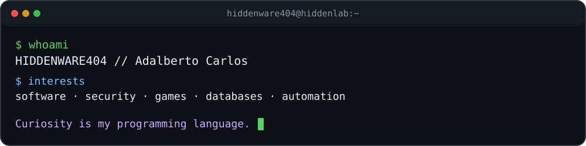

  

  <a href="https://knowyourmeme.com/photos/1764508-konami-code">The Konami Code</a> · referência à cultura dos videogames · autoria original não confirmada

# E aí, dev! 👋

Sou **Adalberto Carlos**, também conhecido como **HIDDENWARE404**.

Gosto de entender como os sistemas funcionam por dentro. Minha curiosidade me leva do desenvolvimento web à segurança de aplicações, passando por jogos, automação e bancos de dados. Este é meu espaço para compartilhar projetos, experiências e o que estou aprendendo pelo caminho.

`BUILD` · `EXPLORE` · `LEARN` · `IMPROVE`

## 🧩 Um pouco sobre mim

Sou autodidata. Gosto de ir além da interface e descobrir o que acontece por trás do código — como uma aplicação conversa com o banco, como os componentes se conectam e como podemos tornar tudo mais seguro.

- 🛡️ Minha trajetória profissional passa pela segurança da informação: atuei como analista de julho de 2022 a abril de 2024, com testes de segurança, análise de vulnerabilidades e controles de acesso.
- 🧪 No tempo livre, gosto de participar de CTFs, montar laboratórios próprios e desenvolver scripts para automatizar tarefas.
- 🎮 Jogos e modding também inspiram meus projetos.
- 💻 Uso o desenvolvimento de software como uma forma de explorar ideias e aprender na prática.
- 🌍 Português nativo e inglês intermediário alto.

Meu interesse em segurança ofensiva está voltado a ambientes de laboratório, CTFs e avaliações autorizadas.

## 🚀 O que estou construindo

### 🛡️ [AIScan](https://github.com/Adalberto069/Aiscan)

  

Uma exploração prática da segurança web: um framework modular de auditoria autorizada de aplicações e APIs, com laboratório local e relatórios técnicos.

[Repositório](https://github.com/Adalberto069/Aiscan) · [Arquitetura](https://github.com/Adalberto069/Aiscan/blob/main/docs/ARCHITECTURE.md)

### 🎮 [Modder's Hub](https://github.com/Adalberto069/modder-s-hub)

  

Um projeto que reúne meu interesse por jogos, comunidades e desenvolvimento web. A plataforma explora catálogo, gerenciamento de conteúdo e colaboração.

[Repositório](https://github.com/Adalberto069/modder-s-hub) · [Aplicação](https://hiddenmod.lovable.app) · [Arquitetura](https://github.com/Adalberto069/modder-s-hub/blob/main/docs/ARCHITECTURE.md)

### 🌌 [HIDDENIA / OSONE](https://github.com/Adalberto069/HIDDENIA)

  

Um assistente digital experimental para explorar interfaces multimodais, memória contextual, workspace e integração de serviços.

[Repositório](https://github.com/Adalberto069/HIDDENIA) · [Arquitetura](https://github.com/Adalberto069/HIDDENIA/blob/main/docs/ARCHITECTURE.md)

## ⚙️ Tecnologias que fazem parte dos meus projetos

Também exploro SQL, Express, Vite, APIs REST, WebSocket, testes e controle de acesso.

## 🎓 Minha trajetória de aprendizado

 

Aprendizado contínuo em cibersegurança, programação, Linux e infraestrutura.

- 🛡️ Treinamento de Segurança Ofensiva e Teste de Invasão — Técnicas de Invasão (100h).
- 🔐 Princípios da Cibersegurança e módulo introdutório da Aceleração Santander — DIO.
- 💻 Lua Fundamentals.
- 🐧 Sistemas operacionais, Linux e máquinas virtuais — DIO.

**[Explorar a central de formação e certificados](certificados/README.md)** — cursos, instituições, datas e cargas horárias.

### 🛠️ Ferramentas de segurança

Áreas de interesse: segurança web, análise de vulnerabilidades, automação de testes e engenharia reversa.

## 🧪 HiddenLab — estudos e experimentos

Nem toda ideia precisa nascer como um produto. Aqui ficam experiências de desenvolvimento, arquitetura, bancos de dados e segurança em diferentes estágios de maturidade.

[Explorar laboratórios](labs/) · [Ver todos os repositórios](https://github.com/Adalberto069?tab=repositories)

## 📊 Minha jornada no GitHub

  
  

Cartões de serviços externos: dados públicos disponíveis; proporção de código não mede domínio de uma linguagem.

### 🏆 Achievements

[Conquistas no perfil do GitHub](https://github.com/Adalberto069?tab=achievements) · [Histórico público de contribuições](https://github.com/Adalberto069#year-list)

### 🐍 Contribution Snake

[Automação de atualização diária](https://github.com/Adalberto069/Adalberto069/actions/workflows/profile-snake.yml)

## 🎮 Easter egg

Quem lembra desse código?

`↑ ↑ ↓ ↓ ← → ← → B A START`

Uma pequena homenagem à cultura gamer e aos segredos escondidos nos jogos.

## 🌐 Conecte-se comigo

English summary 🇬🇧

I'm Adalberto Carlos, also known as HIDDENWARE404. I enjoy exploring how software works, building web projects and learning about databases, automation and application security. This portfolio collects my projects and experiments as I continue learning.

---

<strong>Curiosity is my programming language.</strong>

HIDDENWARE404 · Stay curious. Keep building.

