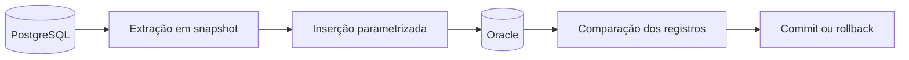

# PostgreSQL → Oracle | Laboratório de migração

Projeto educacional com dados sintéticos de clientes e pedidos. Objetivo: preservar chaves, relacionamentos, valores monetários e conteúdo na migração entre bancos relacionais. Não é uma migração de produção.

## Fluxo

## Mapeamento

| PostgreSQL | Oracle |
| --- | --- |
| INTEGER | NUMBER(10,0) |
| VARCHAR(100) | VARCHAR2(100 CHAR) |
| NUMERIC(12,2) | NUMBER(12,2) |

## Executar

1. Prepare dois bancos de desenvolvimento isolados e usuários específicos para o laboratório.
2. Execute `postgres.sql` no PostgreSQL e `oracle.sql` no Oracle (o destino deve estar vazio). Os scripts criam tabelas novas; não use esquemas de produção.
3. Em um ambiente virtual Python, execute `pip install -r requirements.txt`.
4. Defina as variáveis de ambiente `PG_DSN`, `ORACLE_USER`, `ORACLE_PASSWORD` e `ORACLE_DSN` com os dados dos bancos locais. Nunca publique as credenciais.
5. Execute `python migrate.py`.

O script lê os dados de origem em uma transação com snapshot consistente, preserva identificadores, compara os registros no destino e efetua commit somente após validação. Em falha, faz rollback. Use o destino exclusivamente para este laboratório, sem escritores concorrentes. Não suporta grandes volumes, migração incremental ou objetos arbitrários.

## Critérios de aceitação

- Dois clientes e três pedidos transferidos.
- Identificadores, nomes, vínculos e valores iguais à origem.
- Restrições de integridade ativas.
- Segunda execução rejeitada quando o destino não estiver vazio.
- Falhas não deixam inserções parciais.

**Status:** implementação inicial publicada; execução com PostgreSQL e Oracle ainda não realizada. Não há métricas de desempenho verificadas.
