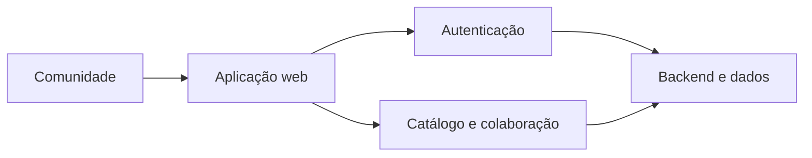

# HiddenMod — Modder's Hub

## Sobre o projeto

HiddenMod é minha plataforma web voltada à comunidade gamer e de modding mobile, publicada em domínio próprio.

**[Conheça a plataforma](https://hiddenmod.com.br/)**

## Funcionalidades do projeto

- Catálogo de scripts e conteúdos com filtros e indicadores de compatibilidade.
- Perfis, reputação e ranking de colaboradores.
- Solicitações da comunidade, tutoriais e ferramentas de moderação.
- Painéis de gerenciamento de conteúdo.

A plataforma continua em desenvolvimento.

## Tecnologias

| Camada | Tecnologias |
| --- | --- |
| Interface | React, TypeScript, Vite, Tailwind CSS |
| Dados e autenticação | Supabase, PostgreSQL |
| Testes | Vitest |

## Arquitetura conceitual

## Portfólio

Esta página apresenta o produto, suas tecnologias e sua arquitetura em alto nível. O código-fonte da aplicação não é distribuído por esta vitrine.

[Site oficial](https://hiddenmod.com.br/) · [Voltar ao perfil](../../README.md)
